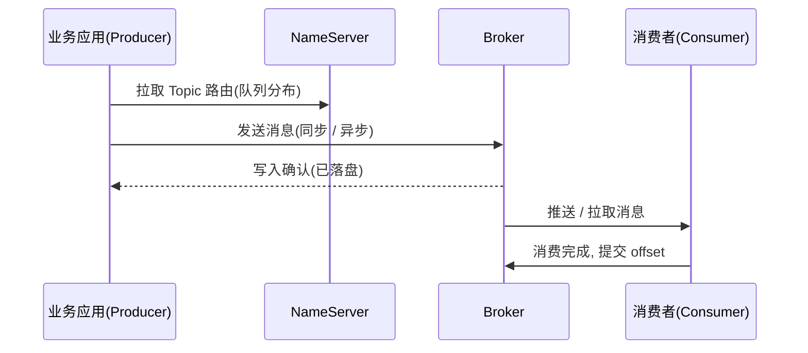

# CoinExchange（CEX 交易所 · Java 后端学习项目）

> 本项目用于**学习 Java 后端开发**，技术栈以 **Spring Cloud** 为主，业务场景围绕一个虚拟货币交易所（CEX）。
> 所有中间件（MySQL / Redis / RocketMQ 等）统一用 `docker-compose.yml` 本地一键拉起。
>
> 文档采用「模块化」组织：每学一块技术，就在这里补一块对应的笔记（作用 + 接入流程 + 踩坑点）。

## 项目结构

```
coinExchange/
├── docker-compose.yml     # 本地中间件全家桶（MySQL/Redis/RocketMQ）
├── rocketmq/
│   └── broker.conf        # RocketMQ Broker 配置
├── README.md              # 本文件：学习笔记总入口
└── <后续模块>/            # 订单服务 / 账户钱包服务 / 行情服务等
```

---

## 模块一：RocketMQ（消息队列）

RocketMQ 在交易所场景里非常核心：撮合结果推送、订单流水、账务异步记账、K 线聚合、风控事件等都依赖它做**异步解耦**和**最终一致**。

### 1. 三个组件分别干什么

| 组件 | 镜像 | 端口 | 角色 |
|------|------|------|------|
| **NameServer** | `apache/rocketmq:5.3.0` | 9876 | **路由中心 / 注册表**。Broker 启动时向它注册（自身 IP、Topic、队列分布），Producer / Consumer 启动时向它拉取路由。它**无状态、节点互不通信**，挂掉一个不影响其它，生产环境一般部署 2 个以上。 |
| **Broker** | `apache/rocketmq:5.3.0` | 10909 / 10911 / 10912 | **真正存储和收发消息**的节点。10911 是业务通道（Spring 客户端连它），10909 是 VIP 通道，10912 是主从同步（HA）通道。消息最终落在其磁盘上。Broker 分 Master / Slave，靠 `brokerRole` 控制。 |
| **Dashboard（控制台）** | `apacherocketmq/rocketmq-dashboard:latest` | 8080 | **可视化运维后台**（老名字叫 `rocketmq-console-ng`）。可查看集群、Topic、消费者组、消息轨迹，也能手动发消息、按 ID 查消息，排错时非常有用。 |

> 一句话区分：`NameServer` 是"通讯录"，`Broker` 是"仓库+收发室"，`Dashboard` 是"监控大屏"。

### 2. 整体架构与消息流转

**部署架构图**


> 若图片未显示，直接打开 `docs/rocketmq-arch.svg`，或看下方文字版说明。

**消息生命周期（按此顺序理解，与图上序号 1→5 对应）**

1. **注册**：Broker 启动后向 NameServer 注册自己的地址、Topic 与队列分布。
2. **拉路由（Producer）**：Producer 启动时向 NameServer 拉取目标 Topic 的路由。
3. **拉路由（Consumer）**：Consumer 订阅时同样向 NameServer 拉取路由。
4. **发消息**：Producer 按路由把消息发给 Broker，Broker 落盘。
5. **投递**：Broker 把消息推给订阅该 Topic 的 Consumer，消费成功后提交 offset。

**一次消息收发的时序**



### 3. 实际开发接入过程（Spring Cloud 视角）

下面以 Spring Boot / Spring Cloud 为例，用官方 starter `rocketmq-spring-boot-starter`。

**① 引入依赖**

```xml
<dependency>
    <groupId>org.apache.rocketmq</groupId>
    <artifactId>rocketmq-spring-boot-starter</artifactId>
    <version>2.3.1</version>
</dependency>
```

**② 配置（application.yml / 各 profile）**

```yaml
rocketmq:
  name-server: localhost:9876          # 对应 compose 映射出来的端口
  producer:
    group: order-producer-group        # 生产者组, 全局唯一
```

> 本地用 `localhost:9876`；若把应用也写进同一个 compose 网络跑，则改用服务名 `rocketmq-namesrv:9876`。

**③ 发消息（Producer）**

> 先澄清两个常见疑问：
> - **`RocketMQTemplate` 不需要你实现**。它是 `rocketmq-spring-boot-starter` 自动装配好的 Bean（读取 `rocketmq.name-server`、`rocketmq.producer.group` 后创建），本质是对原生 `DefaultMQProducer` 的封装。你只要 `@Autowired` 注入、调用方法即可。
> - **消息体不一定要用 `OrderCreatedEvent` 这种 Event 类**。`convertAndSend` / `syncSend` 的 payload 可以是 `String`、`byte[]`、`Map`、任意 POJO，甚至 JSON 字符串。用 POJO 只是"类型安全 + 可读性好"的推荐做法，不是强制。

```java
@Service
public class OrderService {

    @Autowired
    private RocketMQTemplate rocketMQTemplate;

    public void createOrder(OrderCmd cmd) {
        // 1) 发字符串（最省事）
        rocketMQTemplate.convertAndSend("notify-topic", "hello rocketmq");

        // 2) 发 Map（不建类也能发，内部序列化成 JSON）
        Map<String, Object> data = Map.of(
                "orderId", cmd.getOrderId(),
                "userId", cmd.getUserId(),
                "status", "CREATED");
        rocketMQTemplate.convertAndSend("order-topic:created", data);

        // 3) 发 POJO（推荐：类型安全，消费端可直接按类型接收）
        OrderCreatedEvent event = new OrderCreatedEvent(cmd.getOrderId(), cmd.getUserId(), cmd.getAmount());

        //    需要按 key 查消息 / 做幂等时，用 MessageBuilder 设置 KEYS
        Message<OrderCreatedEvent> msg = MessageBuilder
                .withPayload(event)
                .setHeader(RocketMQHeaders.KEYS, event.getOrderId())
                .build();
        SendResult result = rocketMQTemplate.syncSend("order-topic:created", msg);
        log.info("发送结果: msgId={}, status={}", result.getMsgId(), result.getSendStatus());

        // 延迟消息: 第 4 个参数是 delayLevel(3=10s)，RocketMQ 只支持固定级别
        // rocketMQTemplate.syncSend("order-topic", msg, 3000, 3);
    }
}
```

要点：
- 非 `String` 的 payload 默认被 **Jackson 序列化成 JSON**；消费端按监听器泛型反序列化，**收发两端类型必须对应**（发 POJO 就收 POJO，发 String 就收 String）。
- `topic:tag` 写法（如 `order-topic:created`）在发送时指定 tag，消费端用 `selectorExpression` 过滤。
- `syncSend` 会等 Broker 响应并返回 `SendResult`，适合要确认的场景；`convertAndSend` 是便捷写法、不返回结果。
- 强烈建议用 `RocketMQHeaders.KEYS` 设置消息 key（一般用业务主键如 orderId），方便在控制台按 key 查消息，也常作为消费幂等的依据。

**④ 收消息（Consumer）—— 怎么把数据取出来**

消费端就是实现 `RocketMQListener<T>`，**泛型 `T` 决定 `onMessage` 参数如何反序列化**。按需选下面三种写法：

**写法 A：直接收 POJO（最常用）**

```java
@Slf4j
@Service
@RocketMQMessageListener(
    topic = "order-topic",
    selectorExpression = "created",            // 只消费 tag=created
    consumerGroup = "account-consumer-group"   // 同组集群消费，不同组各自收一份
)
public class OrderCreatedConsumer implements RocketMQListener<OrderCreatedEvent> {

    @Override
    public void onMessage(OrderCreatedEvent msg) {   // msg 已经反序列化好
        log.info("收到订单: orderId={}, userId={}, amount={}",
                 msg.getOrderId(), msg.getUserId(), msg.getAmount());
        // 1) 幂等校验（用 msg 里的业务主键）
        // 2) 处理业务（异步记账等）
        // 3) 正常返回 = 消费成功；抛异常 = 触发重试
    }
}
```

**写法 B：收字符串（发送端发的是 String，或你想自己解析 JSON）**

```java
@Slf4j
@Service
@RocketMQMessageListener(topic = "notify-topic", consumerGroup = "notify-consumer-group")
public class NotifyConsumer implements RocketMQListener<String> {

    @Override
    public void onMessage(String body) {   // body 就是发送端的原始字符串
        log.info("收到字符串消息: {}", body);
    }
}
```

**写法 C：收原始 `MessageExt`（要拿 msgId / tag / key / 重试次数等元数据）**

```java
@Slf4j
@Service
@RocketMQMessageListener(topic = "order-topic", consumerGroup = "raw-consumer-group")
public class RawOrderConsumer implements RocketMQListener<MessageExt> {

    private static final ObjectMapper MAPPER = new ObjectMapper();

    @Override
    public void onMessage(MessageExt message) {
        // ---- 取元数据 ----
        String msgId   = message.getMsgId();                 // 消息唯一 ID
        String keys    = message.getKeys();                  // 发送时设的 KEYS
        String tags    = message.getTags();
        int retry      = message.getReconsumeTimes();        // 0 = 首次消费
        String traceId = message.getUserProperty("traceId"); // 自定义属性

        // ---- 取消息体：byte[] -> String -> 对象 ----
        String body = new String(message.getBody(), StandardCharsets.UTF_8);
        log.info("msgId={}, keys={}, tags={}, retry={}, body={}",
                 msgId, keys, tags, retry, body);

        try {
            OrderCreatedEvent event = MAPPER.readValue(body, OrderCreatedEvent.class);
            // handle(event);
        } catch (JsonProcessingException e) {
            log.error("消息体解析失败, body={}", body, e);
            // 解析失败一般不要无限重试：可落库转人工，或按重试策略处理
        }
    }
}
```

**消费语义（必须记住）**
- `onMessage` **正常返回 = 消费成功**，Broker 记录 offset；
- **抛异常 = 消费失败**，触发重试（默认 16 次后进入死信队列 `%DLQ% + 消费组`）；
- 所以业务没处理完时**一定要抛异常**，不能 catch 后静默返回（那等于告诉 Broker 已成功，消息就丢了）。

**⑤ 常见消息类型（学习路线）**

| 类型 | 适用场景 | 关键点 |
|------|----------|--------|
| 普通消息 | 订单流水、通知 | 用同步发送拿确认，保证不丢 |
| 延迟消息 | 撤单超时、解冻保证金 | 只能选**固定级别**（1s/5s/10s/30s/1m…），不能任意时间 |
| 顺序消息 | 同一用户的下单/撤单顺序 | 用 `MessageQueueSelector` 让同 key 落同一队列 + 消费单线程 |
| 事务消息 | 本地事务 + 发消息一致性 | 半消息 + 本地事务回查（`RocketMQLocalTransactionListener`） |

### 4. 容易踩的坑（重点）

1. **宿主机连不上 Broker（Docker 部署头号坑）**
   Broker 启动后会把"自己暴露给客户端的 IP"注册到 NameServer。如果它注册的是容器内部 IP（172.x），你宿主机上的 Spring 应用拿着路由去连就会超时。
   → 本项目在 `rocketmq/broker.conf` 里设了 `brokerIP1 = host.docker.internal`，并在 compose 里配 `extra_hosts: host.docker.internal:host-gateway`，让宿主机经映射端口 `10911` 连上。迁移到 Linux 服务器时要改成真实内网 IP。

2. **`autoCreateTopic`（自动建 Topic）只在开发用**
   本地 compose 开了 `autoCreateTopicEnable=true` 方便上手，但自动建的 Topic **默认队列数很少（通常 4）**，高并发不够；且生产环境应**提前规划并手动创建** Topic 和消费者组，禁止自动建。

3. **消费重复 → 必须做幂等**
   RocketMQ 只保证"至少一次"投递，网络重试、Rebalance、客户端重启都会造成**重复消费**。消费逻辑必须幂等：用唯一业务键（如 orderId）做去重表 / 唯一索引，消费前先查"是否已处理"。

4. **消费失败的重试与死信**
   集群模式下消费失败默认**重试 16 次**，之后进入**死信队列 `%DLQ% + 消费者组`**。要监控死信队列，否则消息"悄悄消失"你都不知道。不要把异常吞掉（catch 后不抛 = 告诉 Broker 已成功）。

5. **消息丢失的三道关口**
   - 生产者端：用**同步发送**并确认结果；要求强一致可用**事务消息**。
   - Broker 端：本地 compose 用 `ASYNC_FLUSH`（异步刷盘，快但宕机丢数据）；生产用 `SYNC_FLUSH`（同步刷盘）。同理 `brokerRole` 生产用 `SYNC_MASTER`。
   - 消费者端：**先处理业务、再提交 offset**；不要在业务没成功时就 return 成功。

6. **顺序消息不是"全局顺序"**
   是**分区顺序**：同一队列内有序。要同一业务维度（如 userId）哈希到同一队列，且对应消费者单线程消费。全局顺序只能单队列，吞吐极差，基本不用。

7. **延迟消息只能选固定级别**
   `syncSend(msg, timeout, delayLevel)`，level 1=1s, 2=5s, 3=10s, 4=30s, 5=1m … 不支持"30 分钟后"这种任意值，需要自己换算到最接近级别或业务层兜底。

8. **消费者组（Consumer Group）语义**
   同一 group 内是**集群消费**（一条消息只被组内一个实例消费）；不同 group 是**广播**（每个 group 都收到一份）。配错 group 会出现"消息被别人消费了 / 重复消费"。

9. **多环境配置**
   dev / test / prod 的 `name-server` 地址不同，务必用 Spring Profile（`application-dev.yml` / `application-prod.yml`）隔离，别硬编码。

### 5. 本地地址速查

| 服务 | 地址 | 备注 |
|------|------|------|
| MySQL | `localhost:3306` | 库 `coin_exchange`，账号 `cex` / 密码见 compose |
| Redis | `localhost:6379` | 密码见 compose |
| NameServer | `localhost:9876` | 应用配 `rocketmq.name-server` |
| Broker（业务） | `localhost:10911` | 由 brokerIP1 自动指向 |
| Dashboard | http://localhost:8080 | 控制台，排错首选 |

---

## 后续模块（占位，学哪块补哪块）

- [ ] 模块二：MySQL 与分库分表（订单/账目数据模型）
- [ ] 模块三：Redis（行情缓存、限流、分布式锁）
- [ ] 模块四：Spring Cloud 服务拆分与注册发现（Nacos / Gateway）
- [ ] 模块五：撮合引擎与下单链路
- [ ] 模块六：账户 / 钱包与账务一致性（事务消息实战）
